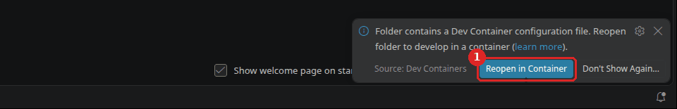
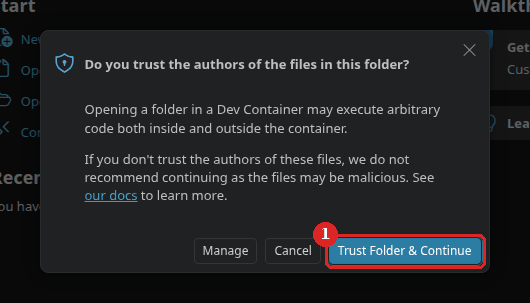
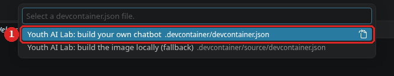
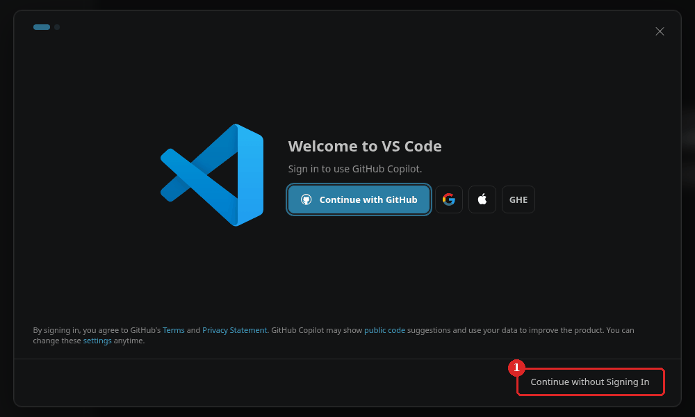
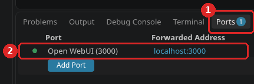
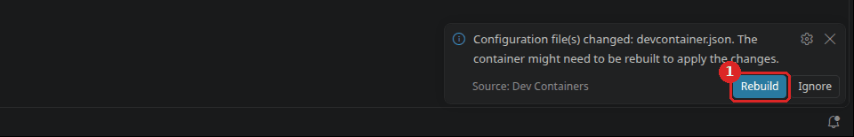

# The workshops and the guides on your own computer

## Youth AI Lab - Erasmus+ project

- **Partners:** L.A.B. (Aix-en-Provence), UAB (Barcelona), Perlatecnica (Naples), Digitale Wolven
  (Antwerp), CSC Vent des Îles (La Rochelle)
- **Need help?**
  - Read the [Troubleshooting](#troubleshooting) section at the end of this guide.
  - Look at, or open, an [issue](https://github.com/Youth-AI-Lab/yal-devcontainer-guide/issues).

> **A guide to follow on your own, in about one hour the first time.** The six workshops and three
> guides of the Youth AI Lab project run in a **GitHub Codespace**: a computer in your browser, with
> nothing to install. This guide is the other way: the **same thing on your own computer**, in a
> *container*. You install a few tools once (Docker, git, and Visual Studio Code with its Dev
> Containers extension), then you open the repository of a workshop or of a guide, and you get the
> same image, the same commands and the same versions as in a Codespace.

This guide is for youth workers, facilitators and educators who prepare or run the workshops of the
project, and for the colleague who helps them with their computer. It does not repeat the
workshops or the guides: once a repository is open, you follow its own README.

---

## Goals

### What you will be able to do

| Part | You will be able to... |
|---|---|
| **1. Install the tools** | Install Docker, git and Visual Studio Code on Linux, macOS or Windows, and check that they work. |
| **2. The Dev Containers extension** | Add the extension that opens a folder inside a container. |
| **3. Open a repository** | Open a workshop, the workshop kit or a guide in its container, and recognise what you should see. |
| **4. Your key** | Save the key of the model in the container, and know where it is kept and when it is lost. |
| **5. Open WebUI in the container** | Start Open WebUI on your computer, and know the disk it needs. |
| **6. A group** | Know why this setup is not for opening a chatbot to a group, and what to use instead. |
| **7. Stop, update, delete** | Stop the containers, move to a new version, and free the disk space at the end. |

### Why this approach?

**The same computer, everywhere.** A Codespace is a container that GitHub runs for you. On your
computer, Docker runs the **same container**, made from the same image: the workshop commands, the
versions of Claude Code and OpenCode, Open WebUI, all identical. What you test at home is what the
pairs get in the room.

**Your work stays with you.** A Codespace stops after 30 minutes without use and is deleted after
30 days without use, and the free quota is limited (60 hours a month on a 2-core machine). On your
computer, none of this: the folder stays as long as you keep it.

**Tested, with the limits we found.** On Linux, in October 2026, we checked Docker, the containers
of six repositories opened from the terminal (two workshops, the kit, three guides), and the Docker
inside them. On 30 October 2026, we also tried in VS Code's windows on
Linux (Ubuntu 26.04.1, VS Code 1.142.0, Dev Containers 0.469.0), with the kit: part 3, the Ports tab
of part 5 and the notification of part 7. Everything
else follows the official documentation of each tool, and is marked **(not tested)**: macOS,
Windows, and in VS Code, closing the window and a Rebuild. If you are the first, tell us how it
went ([issues](https://github.com/Youth-AI-Lab/yal-devcontainer-guide/issues)).

### Is this guide for you?

**Use a Codespace when you can.** It is simpler: one link, nothing to install. This guide is for
the cases where a Codespace does not fit:

- your network or your organisation blocks GitHub Codespaces;
- you have used up the free quota of Codespaces;
- you want to keep your work without the 30-day deletion.

**Not for the participants during a session.** Pairs use Codespaces: installing Docker on ten
laptops takes the whole session. This guide is for you, before and after.

**Not for a model on your own computer.** The model still runs at a provider, with a key, as in a
Codespace. For a model that runs on a computer of your organisation, use the
[local AI guide](https://github.com/Youth-AI-Lab/yal-local-ai-guide).

### Prerequisites

- **A computer** with Linux (Ubuntu 26.04 or 24.04), a Mac with an Apple chip (M1 or later) and
  macOS 15 or later, or Windows 11 in an edition that
  [Docker Desktop supports](https://docs.docker.com/desktop/setup/install/windows-install/#system-requirements).
- At least **8 GB of memory** (measured on Linux only), and at least **20 GB of free disk** for one
  repository (the image and Open WebUI take 4.34 GB + 6.1 GB: see [what it takes](#what-it-takes)).
  For the whole series, count about 29 GB if you keep the four workshops that start Open WebUI.
- The right to **install software** on it (an administrator password). On a computer your
  organisation manages, ask the person who manages it first.
- About **one hour** the first time, most of it waiting for downloads.

> [!WARNING]
> **A technical part.** Part 1 installs system software, and on Linux it changes a setting of the
> system. Every command is given, and what you should see after each one. Do it only if you feel
> confident with this, or with a colleague who does.

**Words used in this guide.** A **terminal** is the window where you type commands. Commands that
start with `sudo` run with the administrator rights: the terminal asks for the computer's password.
An **image** is a ready-made system that Docker downloads once: the same as in a Codespace. A
**container** is a copy of that image running on your computer, with its own files and programs.
A **volume** is disk space that Docker keeps for a container, even after the container is
deleted. A **port** is the number after an address, as 3000 in `localhost:3000`: it tells the
computer which program should answer.

**Are you ready?** You are if you know which repository you want to open (see
[part 3](#part-3---open-a-repository)), and you have its key or subscription ready.

---

## What it takes

Measured on a Linux laptop (Ubuntu 26.04, Docker Engine 29.9), 29 and 30 October 2026.

| What | Size | When |
|---|---|---|
| The image of the workshops (`ghcr.io/youth-ai-lab/yal-workshop-devcontainer:2026.10.38`) | 4.34 GB on disk (a local amd64 build of `2026.10.32`, 30 October 2026; later versions and arm64 not measured) | once, the first time you open any of these repositories |
| Open WebUI, inside the container (`openwebui start`) | 6.1 GB on disk (a 1.6 GB download; 86 s on this connection) | once per container, the first time you start Open WebUI there |
| Open WebUI running | about 1.2 GB of memory (measured in a Codespace) | while it runs |

All the repositories of [part 3](#part-3---open-a-repository) use the **same image**: you download it
once. Each open repository has its **own container**, and each container keeps its own copy of Open WebUI if you start it there:
6.1 GB more for each.

| | Codespace | Your computer |
|---|---|---|
| Image, commands, versions | the pinned image | the same |
| Where your work lives | in the Codespace (deleted after 30 days of no use) | in a folder of your computer |
| Idle stop | after 30 minutes | none |
| The key of the model | `workshop-login` (or `/connect` in OpenCode) | the same, in the container ([part 4](#part-4---your-key)) |
| Open WebUI | works out of the box | its Docker starts, with one setting on some Linux computers; `openwebui start` with a key not tested ([part 5](#part-5---open-webui-in-the-container)) |
| A link for a group | a `…app.github.dev` address | none ([part 6](#part-6---a-group)) |

---

## Part 1 - Install the tools

You need **Docker** (it runs containers), **git** (it downloads a repository) and **Visual Studio
Code** (VS Code, the editor you also see in a Codespace); then, in part 2, its Dev Containers
extension. Follow the section of your system only.

### On Linux (Ubuntu)

Written for Ubuntu 26.04 and 24.04. Other distributions: follow
[Docker's own page](https://docs.docker.com/engine/install/) for step 1, then continue at step 2.

#### Step 1 - Install Docker Engine

> [!WARNING]
> Do not install Docker with `snap` (the Ubuntu software store): VS Code's Dev Containers extension
> does not support it. Use the commands below, from
> [Docker's documentation](https://docs.docker.com/engine/install/ubuntu/).

Open a terminal (`Ctrl+Alt+T`) and copy these lines. They add Docker's own package source, then
install Docker and git. `sudo` asks for your password once.

```bash
sudo apt update
sudo apt install -y ca-certificates curl git
sudo install -m 0755 -d /etc/apt/keyrings
sudo curl -fsSL https://download.docker.com/linux/ubuntu/gpg -o /etc/apt/keyrings/docker.asc
sudo chmod a+r /etc/apt/keyrings/docker.asc
sudo tee /etc/apt/sources.list.d/docker.sources <<EOF
Types: deb
URIs: https://download.docker.com/linux/ubuntu
Suites: $(. /etc/os-release && echo "${UBUNTU_CODENAME:-$VERSION_CODENAME}")
Components: stable
Architectures: $(dpkg --print-architecture)
Signed-By: /etc/apt/keyrings/docker.asc
EOF
sudo apt update
sudo apt install -y docker-ce docker-ce-cli containerd.io docker-buildx-plugin docker-compose-plugin
docker --version
```

**What you should see.** The last line starts with `Docker version` and a number.

#### Step 2 - Use Docker without `sudo`

> [!IMPORTANT]
> A member of the `docker` group can do anything on this computer through Docker, as the
> administrator could ([Docker's explanation](https://docs.docker.com/engine/security/#docker-daemon-attack-surface)).
> Add only yourself, on a computer that is yours to manage.

VS Code runs Docker as you, not as the administrator. Add yourself to the `docker` group:

```bash
sudo usermod -aG docker $USER
```

Then **log out and log in again** (or restart the computer), and check:

<!-- ci linux stage=check expect="Hello from Docker!" -->
```bash
docker run --rm hello-world
```

**What you should see.** A few lines that start with **"Hello from Docker!"**.

#### Step 3 - Install VS Code

Download the `.deb` file from <https://code.visualstudio.com/download>, then:

```bash
cd ~/Downloads
sudo apt install ./code_*.deb
```

If the terminal asks whether to add Microsoft's package source for VS Code, answer **Yes**: VS Code
then updates with your system (**not tested**).

**What you should see.** **Visual Studio Code** in the list of applications. Then go to
[part 2](#part-2---the-dev-containers-extension).

### On macOS (Apple chip) (not tested)

Written for a Mac with an M1 chip or later and macOS 15 or later. We install with **Homebrew**, a free
tool that installs software from the terminal and keeps it up to date.

#### Step 1 - Install Homebrew

Open **Terminal** (in Applications → Utilities). If `brew --version` already shows a version, go to
step 2. Otherwise, copy the line of <https://brew.sh>:

```bash
/bin/bash -c "$(curl -fsSL https://raw.githubusercontent.com/Homebrew/install/HEAD/install.sh)"
```

It asks for your password, may install Apple's command line tools (they bring `git`), and at the end
prints **"Next steps"** with two or three commands to copy: copy them.

**What you should see.** `brew --version` shows `Homebrew` and a version number.

#### Step 2 - Install Docker Desktop and VS Code

> [!IMPORTANT]
> **Docker Desktop's licence.** Docker Desktop is free for personal use, education, non-commercial
> open source projects, and organisations with fewer than 250 employees **and** less than 10
> million dollars of yearly revenue. Larger organisations and government entities need a paid plan.
> Non-profit organisations are not named: if yours is large or public, ask before you install
> ([Docker's terms](https://docs.docker.com/subscription/desktop-license/), checked in October 2026).

```bash
brew install --cask docker-desktop visual-studio-code
```

**What you should see.** The command ends without an error; **Docker** and **Visual Studio Code**
are in Applications.

#### Step 3 - Start Docker Desktop once

Open **Docker** from Applications. The first time, it asks you to accept its terms and may ask for
your password. You can skip the sign-in: an account is not needed. Wait until it says that Docker
is running, then, in Terminal:

```bash
docker run --rm hello-world
```

**What you should see.** **"Hello from Docker!"**. Docker picks the `arm64` version of the
workshop image by itself (published since version `2026.10.27`, checked on an ARM machine before
each publication, but **not yet opened on a real Mac**).

> [!NOTE]
> Docker Desktop gives its containers half of the computer's memory by default: 4 GB on an 8 GB Mac.
> You can change it in Docker Desktop's **Settings** → **Resources** → **Advanced** → **Memory
> limit** ([Docker's settings](https://docs.docker.com/desktop/settings-and-maintenance/settings/)).
> Whether 4 GB is enough for Open WebUI is **not tested**.

Then go to [part 2](#part-2---the-dev-containers-extension).

### On Windows 11 (not tested)

We install with **winget**, the tool of Windows that installs software from the terminal (it comes
with Windows 11). Docker Desktop uses **WSL 2**, a Linux inside Windows. It needs **hardware
virtualization** turned on in the settings of the computer's firmware (BIOS or UEFI)
([Docker's requirements](https://docs.docker.com/desktop/setup/install/windows-install/#system-requirements)):
if your organisation manages the computer, ask the person who does.

#### Step 1 - Install WSL 2

Open **Terminal** as administrator (right-click on the Start button → **Terminal (Admin)**), then:

```powershell
wsl --install
```

Restart the computer if it asks. After the restart, a window may ask you for a user name and a
password for Linux: choose them, and keep them.

**What you should see.** `wsl --status` shows that the default version is **2**.

#### Step 2 - Install Docker Desktop, VS Code and git

Read first the box on [Docker Desktop's licence](#step-2---install-docker-desktop-and-vs-code) in
the macOS section: the same terms apply. Then, in a Terminal (not as administrator):

```powershell
winget install -e --id Docker.DockerDesktop
winget install -e --id Microsoft.VisualStudioCode
winget install -e --id Git.Git
```

**What you should see.** Each command ends with a message that the installation succeeded. Close
the Terminal and open a new one, so that it finds `git`.

#### Step 3 - Start Docker Desktop once

If an installer asks you to restart or to sign out, do it. Then open **Docker Desktop** from the
Start menu. Accept its terms; you can skip the sign-in. Wait until it says that Docker is running,
then, in Terminal:

```powershell
docker run --rm hello-world
```

**What you should see.** **"Hello from Docker!"**.

> [!NOTE]
> If the administrator account that approved the installation is not your own account, Docker's
> documentation says to add your account to the local group **docker-users**, then to sign out and
> in again. With WSL 2, the memory of the containers is set in the settings of WSL (the file
> `.wslconfig`), not in Docker Desktop.

---

## Part 2 - The Dev Containers extension

The **Dev Containers** extension lets VS Code open a folder *inside* a container. It is made by
Microsoft; its identifier is `ms-vscode-remote.remote-containers`.

1. Open VS Code. The first time, a window **Welcome to VS Code** may cover everything: click
   **Continue without Signing In** (a picture is in part 3, step 3).
2. Open the **Extensions** view (`Ctrl+Shift+X`, `Cmd+Shift+X` on a Mac).
3. Search for **Dev Containers**, choose the one by **Microsoft**, and click **Install**.

**What you should see.** The extension shows **Uninstall** instead of **Install**. In the command
palette (`Ctrl+Shift+P`, `Cmd+Shift+P` on a Mac), typing **Dev Containers** lists commands such as
**Dev Containers: Reopen in Container**.

---

## Part 3 - Open a repository

The repositories that use the image of the workshops. **To follow a workshop, open its own
repository**: it has its page, its sheet and only what it needs. The kit presents the series and holds
all the files, but it has no workshop page.

| Repository | What it is | Then follow |
|---|---|---|
| [`yal-workshop-preprompt`](https://github.com/Youth-AI-Lab/yal-workshop-preprompt) | workshop 1 | its README |
| [`yal-workshop-rag`](https://github.com/Youth-AI-Lab/yal-workshop-rag) | workshop 2 | its README |
| [`yal-workshop-search`](https://github.com/Youth-AI-Lab/yal-workshop-search) | workshop 3 | its README |
| [`yal-workshop-tools`](https://github.com/Youth-AI-Lab/yal-workshop-tools) | workshop 4 | its README |
| [`yal-workshop-wiki`](https://github.com/Youth-AI-Lab/yal-workshop-wiki) | workshop 5 | its README |
| [`yal-workshop-finetune`](https://github.com/Youth-AI-Lab/yal-workshop-finetune) | workshop 6 | its README |
| [`yal-workshop-kit`](https://github.com/Youth-AI-Lab/yal-workshop-kit) | the home of the series, with the files of the first five workshops | its README |
| [`yal-openwebui-guide`](https://github.com/Youth-AI-Lab/yal-openwebui-guide) | chatbots for your groups with Open WebUI | its README, part 1 step 2 |
| [`yal-opencode-guide`](https://github.com/Youth-AI-Lab/yal-opencode-guide) | a chatbot of your own with OpenCode | its README, part 1 step 2 |
| [`yal-hermes-guide`](https://github.com/Youth-AI-Lab/yal-hermes-guide) | an assistant to prepare your sessions, never for use with young people | its README |

In the steps below, we open the kit. For a workshop or a guide, change the name of the repository.

> [!WARNING]
> **The container is privileged.** It needs this for its own Docker (part 5). In it, `sudo` asks
> for no password, so any program that runs there can take the administrator rights and reach
> beyond the container (on Linux, the whole computer). In practice:
> - open only the repositories of this table this way;
> - in Open WebUI, never add **Tools** or **Functions** found on the internet: Open WebUI's
>   documentation says that they "execute arbitrary Python code on your server", here in this
>   container;
> - close VS Code when you have finished (part 7).

### On Linux, macOS and Windows

#### Step 1 - Download the repository

In a terminal (on Windows: Terminal, with PowerShell), in a folder where you keep your projects:

<!-- ci linux stage=open -->
```bash
git clone https://github.com/Youth-AI-Lab/yal-workshop-kit.git
```

**What you should see.** A new folder `yal-workshop-kit`.

#### Step 2 - Open it in VS Code

```bash
code yal-workshop-kit
```

If `code` is not found, open VS Code, then **File → Open Folder…** and choose the folder.
VS Code may open it in **Restricted Mode**, with a banner **Restricted Mode is intended for safe
code browsing…**: this is normal, leave it. VS Code asks whether you trust the folder in step 3. If it asks at once
(another version, or another system), answer **Yes, I trust the authors**.

**What you should see.** VS Code shows the files of the repository on the left.

#### Step 3 - Reopen it in the container

VS Code sees the configuration of the container (the `.devcontainer` folder) and shows, at the
bottom right, **Folder contains a Dev Container configuration file.** with the button
**Reopen in Container**: click it. If you missed it (it hides itself after a few seconds), open the
command palette, type **Dev Containers: Reopen in Container** and press Enter.



VS Code may then ask **Do you trust the authors of the files in this folder?**: click
**Trust Folder & Continue**.



**The kit only.** The kit has two configurations, so VS Code asks **Select a devcontainer.json
file.**: choose **Youth AI Lab: build your own chatbot**. The other line, **Youth AI Lab: build the
image locally (fallback)**, is for the facilitator. A workshop or a guide has only one configuration,
and VS Code goes straight on.



The first time, Docker downloads the image (4.34 GB on disk): a few minutes. The next times, the
container opens in a few seconds.

If you did not see it in part 2, a window **Welcome to VS Code** may cover everything now: click
**Continue without Signing In**, then, on the next page (**Make It Yours**), click **Get Started**.
A notification may also ask you to support an extension: close it.



**What you should see.** VS Code reopens. The bottom left corner reads **Dev Container:** and the
name of the container, often cut short. The full name is in the title of the window: for the
workshops and the kit, **Youth AI Lab: build your own chatbot**. The guides have their own names: **Youth AI Lab: group chatbots with Open WebUI**,
**Youth AI Lab: a chatbot with OpenCode**, and **Youth AI Lab: an assistant with Hermes Agent**. Open
a terminal (menu **Terminal → New Terminal**): it greets you with the message of the repository (the
workshops, the kit and the Open WebUI guide: **"Welcome! First, save your API key: workshop-login"**;
the OpenCode guide: **"Welcome! Start the chatbot of this guide with: chatbot"**; the Hermes guide:
**"Welcome! Start the assistant of this guide with: hermes"**). From here on, everything is as in a Codespace: follow the README of the
repository.

> [!IMPORTANT]
> **The Hermes guide.** The first time, the container also installs Hermes Agent: wait until it has
> finished. And [never choose Rebuild Container](https://github.com/Youth-AI-Lab/yal-hermes-guide#step-1---open-your-codespace):
> here too, it deletes your key, what Hermes remembers and your conversations.

> [!NOTE]
> Your files stay in the folder `yal-workshop-kit` on your computer: you see them in the container,
> and you can open them with any other program.

Steps 2 and 3 were tried on Linux (Ubuntu 26.04.1, VS Code 1.142.0, Dev Containers 0.469.0) on
30 October 2026, with the kit. On Windows and macOS, these steps are **not tested**. On Windows, make
sure Docker Desktop is running before step 3.

### The terminal way (optional)

*A technical part.* The same container can be opened without VS Code, with the **Dev Containers
command line**. It is how this guide is checked automatically, and it helps when VS Code does not
show what you expect. It needs **Node.js 20 or later** (`node --version` shows it):

- **Ubuntu 26.04:** `sudo apt install -y nodejs npm`, then the command below as it is.
- **Ubuntu 24.04:** its Node.js (18) is too old: skip the terminal way, or install a newer Node.js
  from <https://nodejs.org> (**not tested**).
- **macOS:** `brew install node`, then the command below **without** `sudo` (**not tested**).

<!-- ci linux stage=cli check="devcontainer --version" expect="0.89.0" -->
```bash
sudo npm install -g @devcontainers/cli@0.89.0
```

**What you should see.** `devcontainer --version` prints `0.89.0`. Then, next to the folder of
step 1:

<!-- ci linux stage=open expect="success" -->
```bash
devcontainer up --workspace-folder yal-workshop-kit
```

**What you should see.** After many lines, a last line with **`"outcome":"success"`**. Then run a
command inside the container:

<!-- ci linux stage=inside expect="opencode v2.1.4" -->
```bash
devcontainer exec --workspace-folder yal-workshop-kit opencode --version
```

**What you should see.** **`opencode v2.1.4`**: the version of OpenCode pinned in the image, the
same as in a Codespace. The other tools are there too, waiting for a key
([part 4](#part-4---your-key)). A container opened this way keeps running until you stop it
([part 7](#stop)).

---

## Part 4 - Your key

Each repository says how to save the key of the model: `workshop-login` in the workshops, the kit and
the Open WebUI guide, `/connect` inside OpenCode in the OpenCode guide, `hermes auth add` in the Hermes
guide. Type it **in a terminal of the
container**: a terminal opened in VS Code while the bottom left corner reads **Dev Container: …**.

**Where the key is kept.** In the home folder of the container (`/home/vscode`): `~/.workshop-key`
for `workshop-login` (readable only by you), `~/.local/share/opencode/` for OpenCode,
`~/.hermes/auth.json` for Hermes. **Never in the
folder of the repository**: it cannot be shared or published with your work by mistake.

**When it is lost.** When the container is made again: **Dev Containers: Rebuild Container**, a new
version of the image ([part 7](#move-to-a-new-version)), or a deleted container. Type it again then.
Closing VS Code or restarting the computer keeps it.

> [!IMPORTANT]
> **The Open WebUI guide.** On your computer, its administrator password for Open WebUI is kept in
> the same home folder of the container, and is lost with it, while Open WebUI keeps its data:
> `openwebui` then says that your administrator password does not open this Open WebUI. Before a
> Rebuild, save your chatbots with `openwebui export` ([part 7](#move-to-a-new-version)).

> [!WARNING]
> Never write the key in a file of the repository folder (a `.env` file, a note, the README), and
> never paste it in a chat with the model. If it happens, delete the key in the console of the
> provider and make a new one.

---

## Part 5 - Open WebUI in the container

The command `openwebui` of the workshops, the kit and the Open WebUI guide runs Open WebUI with the Docker
inside the container. The configuration of the image asks for this by itself: there is nothing to
change in the repository.

1. Follow the README of the repository up to `openwebui start`.
2. The first time, it downloads Open WebUI (a 1.6 GB download, 6.1 GB on disk: 86 s on our
   connection, a few minutes on a slower one).
3. When it is ready, it prints the address. VS Code forwards the port of the container to your
   computer: open the **Ports** tab next to **Terminal**, and click the address on the line
   **Open WebUI (3000)**.

   

**What you should see.** Open WebUI in your browser, at `http://localhost:3000`. If something else
already uses port 3000 on your computer, VS Code picks another number: the **Ports** tab shows it.

> [!IMPORTANT]
> **The Open WebUI guide needs port 3000.** Its Open WebUI accepts only the addresses
> `http://localhost:3000` and `http://127.0.0.1:3000` (read in the command `openwebui`). If the
> **Ports** tab shows another number, close the program that uses port 3000 on your computer, then
> reopen the container.

> [!NOTE]
> **Tested so far.** On Linux, the Docker inside the container starts and downloads Open WebUI (86 s,
> 6.1 GB; 29 October 2026). With the image `2026.10.36`, `openwebui start` also finishes and loads
> its 37 files, without a real key (284 s; October 2026). Opening its page through VS Code, and
> `openwebui start` with a real key, are **not yet tested** outside a Codespace; nor Docker Desktop
> on macOS and Windows.

---

## Part 6 - A group

In a Codespace, `openwebui share open` gives the group a public `…app.github.dev` link. On your
computer there is no such link: **this setup works on this computer only.** You can show it to a
group on a projector, from your own keyboard; the group cannot open it on its own phones or
computers.

> [!WARNING]
> **Do not make the port of the container reachable from other devices.** VS Code has a setting for
> it (**Remote: Local Port Host**); leave it on `localhost`. In the workshops and the kit, Open WebUI has no
> sign-in and uses your key: anyone on the same Wi-Fi would be its administrator, and would use
> your key. The Open WebUI guide has accounts, but its Open WebUI accepts only `localhost:3000`:
> the participants could not use the chat from another device. And never leave the computer to
> participants with VS Code open: its terminal has the administrator rights of the container.

**To open a chatbot to a group without a Codespace**, follow the
[local AI guide](https://github.com/Youth-AI-Lab/yal-local-ai-guide): it installs Open WebUI as a
service on a computer of your organisation, with accounts and the settings for a group. Read first the part
[The participants' data](https://github.com/Youth-AI-Lab/yal-openwebui-guide#the-participants-data)
of the Open WebUI guide.

---

## Part 7 - Stop, update, delete

### Stop

Close the VS Code window: the container stops (**not tested**). Reopen the folder (VS Code lists it
in **File → Open Recent**) to start it again, with your files, your key and Open WebUI's data.

A container opened with the terminal way keeps running after you close VS Code. Stop it from a
terminal of your computer, next to its folder:

```bash
docker stop $(docker ps -q --filter label=devcontainer.local_folder="$PWD/yal-workshop-kit")
```

### Move to a new version

When a repository moves to a new version of the image (after `git pull`, the line `"image"` of
`.devcontainer/devcontainer.json` changes), VS Code shows, at the bottom right,
**Configuration file(s) changed: devcontainer.json. The container might need to be rebuilt to apply
the changes.**, with the buttons **Rebuild** and **Ignore**. Your files stay; the key must be typed
again ([part 4](#part-4---your-key)); Open WebUI keeps its data. The old image stays on the disk
until you delete it (below). We saw this notification on Linux, but did not click **Rebuild**
(**not tested**).



**The Open WebUI guide**: its administrator password is lost with the Rebuild (part 4). Before you
accept:

1. In the terminal of the container, type `openwebui export`: your chatbots go to the folder
   `exports/` of the repository, which stays.
2. After the Rebuild, if `openwebui start` says that your administrator password does not open this
   Open WebUI, type `openwebui reset` (it deletes the accounts and the conversations of the
   participants), then `openwebui start`, then `openwebui import exports/<file>.zip` for each
   chatbot (**not tested** on a computer).

### Delete everything

*A technical part.* Each container keeps its own data in one or two Docker **volumes** whose names
start with `dind-var-lib-` (Open WebUI: 6.1 GB each). Docker does not delete them with the container.
Dev Containers also makes, on Linux, one copy of the image for each repository, with a name that
starts with `vsc-` (it shares its disk with the image).

> [!IMPORTANT]
> **Delete only the containers of this guide.** Other projects opened with Dev Containers on this
> computer have containers and `dind-var-lib-` volumes too. The commands below choose the
> container by the folder of the repository: type them next to the folder of part 3, step 1.
> **The Open WebUI guide:** first save the chatbots you want to keep (`openwebui export`). This step
> deletes the participants' accounts and conversations, as deleting a Codespace would.

On Windows, use Docker Desktop instead (**not tested**): **Containers** (delete those of the
repositories), **Volumes** (their `dind-var-lib-…` volumes), **Images**
(`ghcr.io/youth-ai-lab/yal-workshop-devcontainer`, and `vsc-…` images if there are some).

1. Close VS Code. **See** the container of the repository (here, the kit), its volumes, and the
   images:

   <!-- ci linux stage=delete expect="dind-var-lib-docker-" expect="vsc-yal-workshop-kit-" -->
   ```bash
   id=$(docker ps -aq --filter label=devcontainer.local_folder="$PWD/yal-workshop-kit")
   docker inspect -f '{{.Name}} {{range .Mounts}}{{.Name}} {{end}}' $id
   docker image ls --format '{{.Repository}}:{{.Tag}}' | grep -E '^(vsc-yal-workshop-kit-[0-9a-f]{64}-uid|ghcr.io/youth-ai-lab/yal-workshop-devcontainer):'
   ```

   **What you should see.** The name of the container and its volumes (`dind-var-lib-docker-…`, and with
   newer images also `dind-var-lib-containerd-…`), then
   one `vsc-yal-workshop-kit-…` image and, often, the image of the workshops. If the first command shows an
   error, the container was already deleted.

2. **Delete** the container, its volumes and its copy of the image (the files of your folder stay):

   <!-- ci linux stage=delete check="docker ps -aq --filter label=devcontainer.local_folder=$PWD/yal-workshop-kit | grep -q . || echo container deleted" expect="container deleted" -->
   ```bash
   vol=$(docker inspect -f '{{range .Mounts}}{{if eq .Type "volume"}}{{.Name}} {{end}}{{end}}' $id)
   docker rm -f $id
   docker volume rm $vol
   docker image rm $(docker image ls --format '{{.Repository}}:{{.Tag}}' | grep -E '^vsc-yal-workshop-kit-[0-9a-f]{64}-uid:')
   ```

   Do the same two steps for each other repository you opened, with its name instead of
   `yal-workshop-kit`.

3. **At the very end**, when no repository uses it any more, delete the image of the workshops (all
   its versions):

   <!-- ci linux stage=delete check="docker image ls -q ghcr.io/youth-ai-lab/yal-workshop-devcontainer | grep -q . || echo image deleted" expect="image deleted" -->
   ```bash
   docker image ls -q ghcr.io/youth-ai-lab/yal-workshop-devcontainer | xargs -r docker image rm
   ```

   **What you should see.** A few lines `Untagged:` and `Deleted:`, or nothing: on some computers,
   Docker keeps only the copy of step 2, and there is then nothing more to delete.

4. **On Linux, if an earlier version of this guide made you load `iptable_nat` at each start**, and
   no other program needs it:

   ```bash
   sudo rm /etc/modules-load.d/iptable_nat.conf
   ```

   The part of the kernel stays loaded until the next restart of the computer.

---

## Limits to know

- **macOS and Windows are not tested.** Their steps follow the documentation of each tool. The
  steps in VS Code's windows (part 3, the Ports tab of part 5, the notification of part 7) were tried on Linux (Ubuntu 26.04.1, VS Code
  1.142.0, Dev Containers 0.469.0) on 30 October 2026; closing the window (part 7) and a Rebuild
  are not tested.
- **`openwebui start` with a key is not tested outside a Codespace**, nor Docker Desktop's Docker
  inside a container ([part 5](#part-5---open-webui-in-the-container)).
- **No group** ([part 6](#part-6---a-group)): use the local AI guide.
- **The disk.** About 10 GB with Open WebUI (4.34 + 6.1 GB), plus 6.1 GB for each other
  repository where you start it: about 29 GB for the four workshops that use it.
- **The container is privileged** ([part 3](#part-3---open-a-repository)).
- **The model still needs the internet** and a key, as in a Codespace.

## Commands

| Command | Where | What it does |
|---|---|---|
| `docker run --rm hello-world` | your computer | checks that Docker works |
| **Dev Containers: Reopen in Container** | VS Code | opens the folder in its container |
| **Dev Containers: Rebuild Container** | VS Code | makes the container again (the key is lost) |
| `devcontainer up --workspace-folder <folder>` | your computer | the same as Reopen in Container, without VS Code |
| `devcontainer exec --workspace-folder <folder> <command>` | your computer | runs a command in the container |

## Troubleshooting

### VS Code does not show "Reopen in Container"

Check that the extension **Dev Containers** is installed (part 2) and that you opened the folder of
the repository itself (the one that contains `.devcontainer`), not the folder above it.

### "Cannot connect to the Docker daemon"

On your computer: Docker is not running. On Linux: `sudo systemctl start docker`. On macOS and
Windows: open Docker Desktop and wait until it says that Docker is running.

### "permission denied while trying to connect to the Docker daemon socket"

On Linux: you are not yet in the `docker` group, or you have not logged out since (part 1, Linux,
step 2).

### Docker Desktop or WSL says that virtualization is not enabled

Hardware virtualization must be turned on in the firmware of the computer (BIOS or UEFI). The way
to do it depends on the computer: ask the person who manages it.

### `openwebui` says that Docker is not available

The Docker inside the container did not start. In the terminal of the container:

```bash
tail -3 /tmp/dockerd.log
```

If you read **`iptables failed: iptables --wait -t nat -N DOCKER`** and **"Perhaps iptables or your
kernel needs to be upgraded"**, your copy of the repository uses an image older than `2026.10.31`.
These images need a part of the Linux kernel (the core of the system), `iptable_nat`, that some
recent systems do not load by themselves (we met this on Ubuntu 26.04 with its 7.0 kernel). The best
fix is to [move to a new version](#move-to-a-new-version). If you must keep this one, on Linux, load
that part until the computer restarts:

```bash
sudo modprobe iptable_nat
```

The command prints nothing when it works. Then close the VS Code window and open the folder again
(**File → Open Recent**): the container starts again, and its Docker with it, and your key stays
(**not tested**; with the terminal way: `docker restart` followed by the ID of the container).

If you read something else, copy these lines in an
[issue](https://github.com/Youth-AI-Lab/yal-devcontainer-guide/issues).

### "Your administrator password does not open this Open WebUI"

The Open WebUI guide, after a Rebuild: see [part 7](#move-to-a-new-version).

### The disk is full

Open WebUI takes 6.1 GB **per container** where you started it. Delete the containers and volumes
you do not use any more ([part 7](#delete-everything)).

If you deleted a container another way (for example in Docker Desktop, or with its folder), its
volumes may still be there. This lists the `dind-var-lib-` volumes that **no container uses**:

```bash
docker volume ls --filter dangling=true --filter name=dind-var-lib-
```

They may also belong to other projects of this computer: delete only those you are sure of, with
`docker volume rm` followed by the name.

### The key is asked again

The container was made again (Rebuild, or a new version of the image): this is expected
([part 4](#part-4---your-key)).

---

## Going further

- Visual Studio Code, [Developing inside a Container](https://code.visualstudio.com/docs/devcontainers/containers)
- [Dev Containers command line](https://github.com/devcontainers/cli)
- Docker: [Engine on Ubuntu](https://docs.docker.com/engine/install/ubuntu/),
  [Docker Desktop on Mac](https://docs.docker.com/desktop/setup/install/mac-install/),
  [Docker Desktop on Windows](https://docs.docker.com/desktop/setup/install/windows-install/)
- The series: [the six workshops](https://github.com/Youth-AI-Lab/yal-workshop-kit#the-series) and
  [the other guides](https://github.com/Youth-AI-Lab/yal-workshop-kit#going-further)

## About

Written for the Youth AI Lab project (Erasmus+), October 2026. Tested on Ubuntu 26.04 (kernel 7.0,
Docker Engine 29.9, Dev Containers command line 0.89.0) with the image `2026.10.30` (and `2026.10.31`
for the Docker inside the container and the deletion of part 7), on 29 October
2026: Docker (already installed: the install commands of part 1 come from Docker's documentation),
the failure of the Docker inside the container without `iptable_nat` with the image `2026.10.30`,
then the fix, the containers of the kit and of the Open WebUI and OpenCode guides opened with the command line, the
Docker inside them, the download of Open WebUI. The workflow [`guide.yml`](.github/workflows/guide.yml) follows the Linux
commands of this guide at each change, on Ubuntu 24.04 and 26.04, for six repositories: workshops 1 and
5, the kit, and the Open WebUI, OpenCode and Hermes guides ([`ci/README.md`](ci/README.md)): green on GitHub on 30 October 2026, with the image `2026.10.35`. Tried on Linux (Ubuntu 26.04.1, VS Code 1.142.0, Dev Containers 0.469.0, Docker 29.9.1) on 30 October 2026, with a clone of the kit: part 3 steps 2 and 3 in VS Code's windows, the **Ports** tab, and the notification of part 7 after a change of the image (not the Rebuild itself); the screenshots come from this test. With the image `2026.10.36`, on Ubuntu 26.04.1 (kernel 7.0.0-38, Docker 29.9.1) with `iptable_nat` not loaded: the Docker inside the container, a published port and the outgoing network after a restart, on 30 October 2026; `openwebui start` without a real key (284 s, 37 files, a search that works). Not tested: closing the VS Code window (part 7), the Rebuild, macOS, Windows, `openwebui start` with a key.

Texts: [CC BY-SA 4.0](LICENSES/CC-BY-SA-4.0.txt). Configuration and scripts:
[EUPL-1.2](LICENSES/EUPL-1.2.txt). See [`REUSE.toml`](REUSE.toml).
